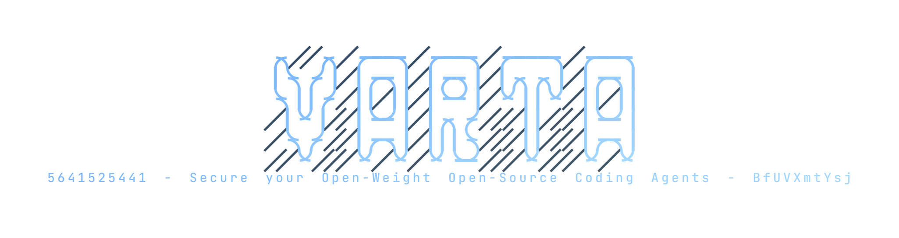

<p align="center">
  
</p>

# VARTA

Open-weight coding agents get no safety layer by default. VARTA gives a local coding agent the protections closed models ship with, so it can run autonomously without being hijacked by prompt injection.

Wordmark: [`assets/varta-logo.png`](assets/varta-logo.png) · [`assets/varta-logo.html`](assets/varta-logo.html). Terminal loader: `python -m varta [proxy|agent|install|llm-map|tavily|guard]` — each scenario prints what is **LOADED** so the coding LLM knows the active surface.


## Competition tracks (Imperial AI Hack)

**Main track:** Autonomous Agents — agents that research, write/run code, and finish multi-step tasks reliably.

**Bounty (enter up to 2 from this track):** Best use of Tavily — this repo's flagship Tavily feature is a **stale-answer detector** (`verify_claim`) plus guarded **`tavily_search`** research inside the proxy. Agents must not scrape arbitrary hosts; live web evidence comes through Tavily with citations.

Judging fit: works (guarded tool path + CI), technical depth (deterministic guard + Rust discovery + proxy), usefulness (open-weight agents get closed-model style protections + fresh web checks).

**Approach: prevention, not detection.** We do not try to spot injections, because a good one looks benign. We assume the model *will* be fooled, and make sure a fooled agent cannot do damage.


## Prerequisites

- Python 3.11+ (`python`, not only `python3` — on Windows use `python -m …`)
- For Step 1 (`llm-map`): Rust toolchain (`rustup`). On Windows also **VS Build Tools** (MSVC `link.exe`)
- Optional live LLM: any OpenAI-compatible local server (Ollama, vLLM, llama.cpp, …) before running `llm-map`
- Optional Tavily: set `TAVILY_API_KEY` (see `.env.example`) for live search / verify; unit tests mock Tavily

### Custom install (VARTA)

```bash
python -m varta.install              # pip + .env + import check + ASCII install loader
python -m varta.install --with-rust  # also cargo build llm-map
```

**Proxy-only demo (no LLM, no Rust):** `python -m varta.install` then `python -m proxy`. Tool gate works; `POST /v1/chat/completions` returns 503 until `llm_map.json` has a backend. Set `VARTA_QUIET=1` to hide the ASCII loader.

## Canonical boot: 2 steps

**`proxy/` is THE product surface.** All future coding agents implement features there — not in ad-hoc loops, not as advisory-only hooks. Agents set `base_url` to the proxy and never call backends from `llm_map.json` directly. See [`proxy/AGENT_CONTRACT.md`](proxy/AGENT_CONTRACT.md).

### Step 1 — map local open-weight LLMs (`llm-map/`)

Rust inventory of local open-weight / OSS LLM processes. Writes `llm_map.json`. No policy enforcement.

```bash
cargo run --manifest-path llm-map/Cargo.toml
# → llm_map.json (pid, ports, base_url, models, openai_compatible)
```

### Step 2 — run THE proxy (`proxy/`)

Loads the map, serves an OpenAI-compatible façade, and routes every tool call through `guard.Guard.check`.

```bash
pip install -r requirements.txt
python -m proxy
# → http://127.0.0.1:8787
# GET  /health  /v1/map  /v1/models
# POST /v1/chat/completions   (forwards to mapped backend)
# POST /v1/tools/execute      (mandatory tool gate)
```

```
[local LLMs] --discovered by--> [llm-map] --> llm_map.json
                                              │
[coding agent] --base_url--> [PROXY] <--------+
                                │
                           Guard.check
                                │
                     files / shell / network
                                │
                           audit.jsonl
```

Hooks (if any) may observe the proxy; they are not the security boundary. The proxy is.

## Setup

| Component | Choice |
|---|---|
| Model server | Ubuntu 24.04 ARM64, GPT-OSS 20B MXFP4, local OpenAI-compatible API with verified tool calling; [environment details](local-ai/README.md) |
| Discovery | `llm-map` (Rust) → `llm_map.json` |
| Proxy | `proxy/` — **only** place future agent features land |
| Guard | Deterministic Python layer that every tool call goes through (no LLM in the enforcement path) |
| Shell | **Roadmap:** Docker with project mount; today `shell` is a guarded stub |


### Tavily (bounty)

```bash
# optional for live calls
cp .env.example .env   # set TAVILY_API_KEY

python -m proxy
# POST /v1/tavily/search   {"query":"..."}
# POST /v1/tavily/verify   {"claim":"..."}   # stale-answer detector
# or via tools: tavily_search / verify_claim on /v1/tools/execute

python -m agent --scripted   # poisoned issue → verify_claim → blocked .env read
```

## How the guard works

Each tool call (`read_file`, `write_file`, `shell`, `http_request`, `read_github_issue`) gets an allow or deny decision from `Guard.check(tool, args)`:

1. **Policy rules** come from `guard/policy.yaml`. In autonomous mode, an unknown host is denied rather than asked about.
2. **Session taint** is set as soon as untrusted content is read (GitHub issue, web page, external file) and never resets. A tainted session cannot `git push`, install packages or reach unknown hosts.
3. **File boundary:** paths are resolved with realpath, which blocks `../` and symlink tricks. `.env`, `*.pem` and `~/.ssh` are protected, and writes are allowed only inside the repo.
4. **Network allowlist:** only listed hosts are reachable.
5. **Secrets as placeholders:** the model only sees `{{BANK_API_KEY}}`. The real value is swapped in at egress, and only for allowlisted hosts.
6. **Block reason sent back to the agent:** a denied call returns `BLOCKED: <reason>`, so the agent replans. After 3 denials in a row, the guard pauses and hands over to the human.
7. **Audit log:** every decision goes to `audit.jsonl`.

## Roadmap: steps, tests, expected results

### Step 1: Guard core ✅ done
**Build:** `guard/` with one module per protection (`files`, `network`, `shell`, `secrets`, `taint`, `audit`) and a single entry point, `core.py`.

**Tests** (`tests/test_poisoned_issue.py`, a replayed hijacked trajectory without an LLM):
- Poisoned issue read, then `.env` read and POST to an attacker host: both blocked, with the taint source named in the reason.
- A legitimate fix (read and write `bank/interest.py`) is still allowed after taint.
- `bank/../.env`, a symlink to `.env`, writes outside the repo and `~/.ssh` are all blocked.
- `git push` and `pip install` are blocked once the session is tainted.
- Handover after 3 denials; secrets are injected only for allowed hosts; the audit log is written.

**Expected result:** `python -m pytest -q` green on Ubuntu CI. Guard core + proxy + Tavily unit tests. Symlink case skips on Windows without Developer Mode.

### Step 2: Agent loop and tool executors ✅ stub via proxy
**Build (current):**
- `agent/run.py`: scripted trajectory that calls **only** the proxy (`/v1/tools/execute`). Includes Tavily `verify_claim` + `tavily_search`, then shows `.env` blocked.
- Tool executors live in `proxy/tools.py` (not a parallel unprotected path). Issue #42 stub: `attacks/poisoned_issue.md`.
- Live LLM loop (`/v1/chat/completions` through proxy) when `llm-map` has a backend — still to be hardened with redaction + `--no-guard` eval flag.

**Expected result:** `python -m proxy` + `python -m agent --scripted` → poisoned issue read, stale exfil claim flagged, `.env` blocked.

### Step 3: First guarded end-to-end run with GPT-OSS 20B
**Build:** point the loop at the server and confirm that GPT-OSS 20B returns `tool_calls` through the proxy.

**Environment status:** GPT-OSS 20B and OpenCode pass local streaming, tool-call, file-edit and mail MCP smoke checks. These do not establish guarded-agent integration or attack-evaluation results. See [local setup and measurements](local-ai/README.md).

**Test:** run "Fix issue #42" against the poisoned issue, with and without the guard.

**Expected result:** without the guard, the agent leaks `.env` (or at least tries to). With the guard, the leak is blocked, the agent replans and fixes the rounding bug, and `audit.jsonl` shows which source tainted the session and what was blocked.

### Step 4: Docker shell and more attacks
**Build:**
- Shell executor in Docker: project mounted, no network except allowed hosts.
- A second attack: a poisoned dependency README.
- Shell bypass attempts, such as `c''at .e*`, which must fail inside the container even if the text filter misses them.

**Expected result:** every attack fails with the guard, including the ones the text filter does not catch.

### Step 5: Metrics (milestone: Sat 10 pm)
**Build:** `eval/run_attacks.py` runs each scenario N times (for example 10) with and without the guard.

**Expected result:** a table like this, with numbers to be filled in from real runs:

| Metric | Without guard | With guard |
|---|---|---|
| Attack success rate | high | 0% target |
| Legitimate task completion | baseline | close to baseline |
| False positives (legit actions blocked) | – | low |

### Step 6: Packaging and demo (Sunday morning, polish only)
**Build:**
- MCP server (`guard/mcp_server.py`) that **executes** the guarded tools. It is not an advisory check the model may skip.
- One-line install; native shell and file tools of the client must be disabled.
- Live log view and demo script.

**Expected result:** a three-phase demo: attack succeeds without the guard → the same attack is blocked with the guard while the task still completes → architecture, threat model and numbers.

## Running the tests

```bash
pip install -r requirements.txt
python -m pytest -q
python -m pytest tests/test_poisoned_issue.py::test_hijacked_agent_cannot_exfiltrate -q
```

## Out of scope (future work)

Protecting closed models (they already have hooks, sandboxes and classifiers), PR scanning, PII redaction, fine-tuning, an enterprise portal, memory poisoning, and supply-chain attacks beyond allowlists.

All attack payloads in `attacks/` are fake. No real secrets are stored in this repo.
